# Implementasi Heuristik Round Robin pada Kubernetes

**Kelompok 5 - Institut Teknologi Sepuluh Nopember**

Proyek ini menjalankan penjadwalan task **Round Robin (RR)** pada Kubernetes lokal menggunakan **Docker Desktop, Ubuntu WSL 2, dan kind**. Dataset tetap menggunakan GoCJ dari eksperimen sebelumnya. Pekerjaan CPU benar-benar dijalankan dalam pod, kemudian waktu eksekusi, checksum dan statusnya dicatat.


## Daftar isi

1. [Arsitektur sistem](#arsitektur-sistem)
2. [Cara kerja penjadwalan](#cara-kerja-penjadwalan)
3. [Dataset dan beban komputasi](#dataset-dan-beban-komputasi)
4. [Hasil eksperimen](#hasil-eksperimen)
5. [Foto dokumentasi eksekusi 100-1000 task](#foto-dokumentasi-eksekusi-100-1000-task)
6. [Menjalankan dan membaca hasil](#menjalankan-dan-membaca-hasil)
7. [Struktur implementasi](#struktur-implementasi)

## Arsitektur sistem

### Susunan komponen

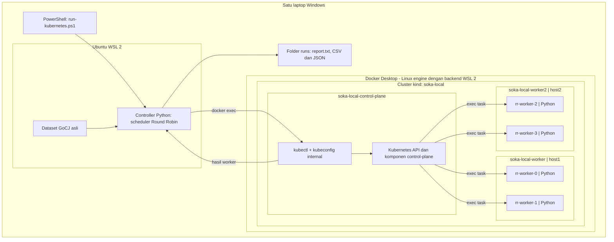

Controller Python berjalan di Ubuntu WSL, **di luar cluster**. Pada profil kind, controller menjalankan kubectl di container control-plane melalui Docker. Kubectl menggunakan API Kubernetes untuk mengirim pekerjaan ke pod tujuan. Jalur ini menghindari ketergantungan pada port API yang dipublikasikan ke Windows/WSL, tanpa mengganti pekerjaan nyata dengan simulasi.

### Peran setiap komponen

| Komponen | Fungsi dalam implementasi |
|---|---|
| PowerShell | Pintu masuk perintah setup, inspect, verify, run dan results |
| Ubuntu WSL 2 | Menjalankan Python controller, kind dan akses Docker |
| Docker Desktop | Engine Linux yang dipakai pada eksperimen terdokumentasi |
| kind | Membentuk node Kubernetes sebagai container Docker |
| Control-plane | Mengelola API dan penempatan pod; tidak menjalankan empat antrean task RR |
| Dua worker node | Masing-masing menampung kedua komputasi |
| Empat Python | Mengerjakan task hash sesuai antrean yang ditentukan RR |
| File hasil | Menyimpan bukti placement, pemetaan task, checksum, waktu dan status |

### Penempatan worker dan sumber daya

| Node | Pod | Indeks RR | CPU request / limit | RAM request / limit |
|---|---|---:|---|---|
| soka-local-worker | rr-worker-0 | 0 | 100m / 1 CPU | 32 MiB / 128 MiB |
| soka-local-worker | rr-worker-1 | 1 | 100m / 1 CPU | 32 MiB / 128 MiB |
| soka-local-worker2 | rr-worker-2 | 2 | 100m / 1 CPU | 32 MiB / 128 MiB |
| soka-local-worker2 | rr-worker-3 | 3 | 100m / 1 CPU | 32 MiB / 128 MiB |

Manifest menggunakan nodeSelector dengan label `soka.lab/host=host1` dan `host2`. Sebelum dispatch, program membaca nodeName aktual, kesiapan node/pod dan UID pod. Dengan demikian, penempatan dua pod per worker diperiksa melalui API, bukan hanya diasumsikan dari konfigurasi.

Semua node berbagi CPU/RAM laptop. Limit 1 CPU per pod bukan reservasi satu core fisik. Total terdapat tiga node Kubernetes: satu control-plane dan dua worker.

## Cara kerja penjadwalan

### Dua keputusan yang berbeda

**Kubernetes menempatkan pod pada node**, sedangkan **algoritma Round Robin proyek membagikan task pada pod**. Proyek tidak mengganti scheduler internal Kubernetes.

Rumus Round Robin:

```text
worker_index = task_index % 4
```

| Task (indeks mulai 0) | Pod tujuan | Node |
|---:|---|---|
| 0 | rr-worker-0 | soka-local-worker |
| 1 | rr-worker-1 | soka-local-worker |
| 2 | rr-worker-2 | soka-local-worker2 |
| 3 | rr-worker-3 | soka-local-worker2 |
| 4 | rr-worker-0 | soka-local-worker |
| 5 | rr-worker-1 | soka-local-worker |
| 6 | rr-worker-2 | soka-local-worker2 |
| 7 | rr-worker-3 | soka-local-worker2 |

Setiap pod menjalankan antreannya **secara serial**, sementara keempat antrean berjalan **paralel**. Pada 100 task, masing-masing pod menerima 25 task; pada 1000 task, masing-masing menerima 250 task. RR meratakan jumlah task, bukan menjamin durasi sama karena panjang pekerjaan berbeda-beda.

### Alur satu eksperimen

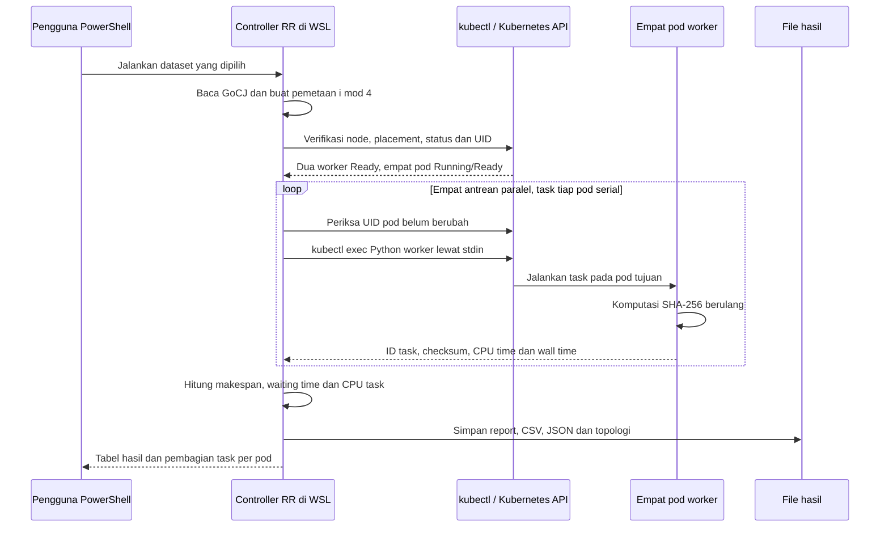

Jika verifikasi awal gagal, task tidak dikirim. Jika suatu task gagal, status/error dicatat dan run keluar dengan exit code 1 setelah antrean selesai. Tidak ada pengalihan otomatis ke pod lain. UID diperiksa sebelum setiap task untuk menolak pod yang sudah diganti selama eksperimen.

## Dataset dan beban komputasi

Seluruh **22 file sumber GoCJ sebelumnya** tetap tersedia di [data/](data/README.md), termasuk 19 dataset berukuran 100-1000 task dengan kenaikan 50. Workbook Monte Carlo, data original dan generator historis dipertahankan. [manifest.json](data/manifest.json) mencatat ukuran dan SHA-256 untuk pemeriksaan keutuhan file.

Dataset GoCJ berisi panjang/bobot pekerjaan, bukan program executable. Dalam implementasi ini:

```text
jumlah iterasi SHA-256 = panjang task GoCJ x iterations-per-mi
skala eksperimen yang ditampilkan = 10
```

Worker benar-benar memakai CPU dalam pod dan menghasilkan checksum. Nilai MI menjadi skala beban, bukan pengukuran instruksi hardware nyata atau eksekusi pekerjaan asli Google. Tidak ada data task baru yang dibuat untuk menggantikan GoCJ.

## Hasil eksperimen

Tabel berikut menggunakan **run yang sama dengan foto dokumentasi**, untuk 100, 200, sampai 1000 task. Seluruh foto menampilkan RR pada cluster `soka-local`, skala 10, dan jumlah task gagal 0.

| Task | Task per pod | Makespan (s) | Waktu tunggu rata-rata (s) | CPU task (%) | Selesai / gagal | Foto |
|---:|---:|---:|---:|---:|---|---|
| 100 | 25 | 34.303 | 15.046 | 56.38 | 100 / 0 | [Lihat](docs/images/task-0100.jpg) |
| 200 | 50 | 78.396 | 38.183 | 56.35 | 200 / 0 | [Lihat](docs/images/task-0200.jpeg) |
| 300 | 75 | 123.276 | 59.969 | 58.16 | 300 / 0 | [Lihat](docs/images/task-0300.jpeg) |
| 400 | 100 | 158.452 | 72.170 | 56.64 | 400 / 0 | [Lihat](docs/images/task-0400.jpeg) |
| 500 | 125 | 187.053 | 86.778 | 57.05 | 500 / 0 | [Lihat](docs/images/task-0500.jpeg) |
| 600 | 150 | 227.250 | 106.995 | 58.70 | 600 / 0 | [Lihat](docs/images/task-0600.jpeg) |
| 700 | 175 | 209.217 | 100.478 | 54.96 | 700 / 0 | [Lihat](docs/images/task-0700.jpeg) |
| 800 | 200 | 226.290 | 112.548 | 57.12 | 800 / 0 | [Lihat](docs/images/task-0800.jpeg) |
| 900 | 225 | 264.174 | 126.332 | 59.18 | 900 / 0 | [Lihat](docs/images/task-0900.jpeg) |
| 1000 | 250 | 302.552 | 141.772 | 56.41 | 1000 / 0 | [Lihat](docs/images/task-1000.jpeg) |

**Metrik:** makespan mencakup overhead controller/kubectl; waktu tunggu dihitung sampai pemanggilan task; utilisasi CPU task dihitung terhadap kapasitas waktu empat limit CPU pod, bukan seluruh laptop. Setiap ukuran menggunakan file dataset GoCJ sendiri, sehingga makespan tidak harus meningkat secara monoton terhadap jumlah task.

Angka dalam tabel adalah satu run terpilih per ukuran, bukan rata-rata beberapa pengulangan. Khusus 100 task, foto memakai run `20261030-230143` (34,303 detik); pembacaan hasil terbaru dapat memilih run 100 task lain. Ringkasan yang konsisten dengan foto tersedia di [hasil-dokumentasi.csv](docs/hasil-dokumentasi.csv); pemetaan foto ke run dan checksum gambar ada di [documentation-index.json](docs/documentation-index.json).

Seluruh 19 ukuran dataset memiliki hasil tersimpan. Galeri berikut menampilkan 10 ukuran kelipatan 100, sesuai foto yang tersedia; tidak membuat foto pengganti untuk ukuran 150, 250, dan seterusnya.

## Foto dokumentasi eksekusi 100-1000 task

Foto merupakan screenshot hasil pengguna yang disalin tanpa mengubah isi. Setiap gambar memperlihatkan dataset, metrik dan pembagian task ke empat pod.

### 100 task

100 task selesai, 0 gagal; setiap pod menerima 25 task. Makespan **34.303 detik**.

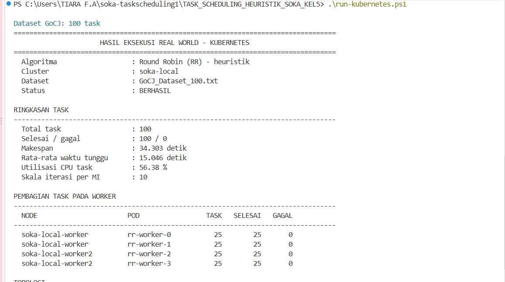

Sumber data: [summary.json](runs/20261030-230143/summary.json) dari run `20261030-230143`.


### 200 task

200 task selesai, 0 gagal; setiap pod menerima 50 task. Makespan **78.396 detik**.

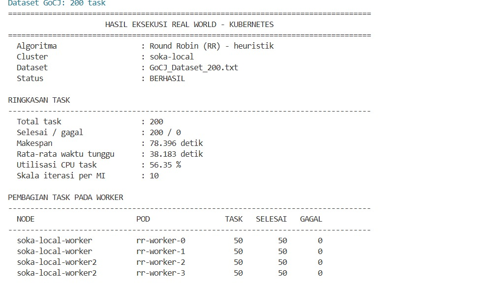

Sumber data: [summary.json](runs/20261030-230710/summary.json) dari run `20261030-230710`.


### 300 task

300 task selesai, 0 gagal; setiap pod menerima 75 task. Makespan **123.276 detik**.

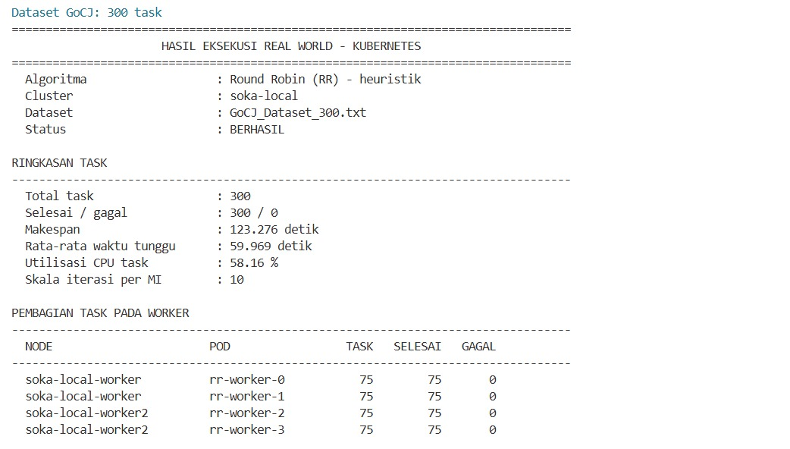

Sumber data: [summary.json](runs/20261030-231004/summary.json) dari run `20261030-231004`.


### 400 task

400 task selesai, 0 gagal; setiap pod menerima 100 task. Makespan **158.452 detik**.

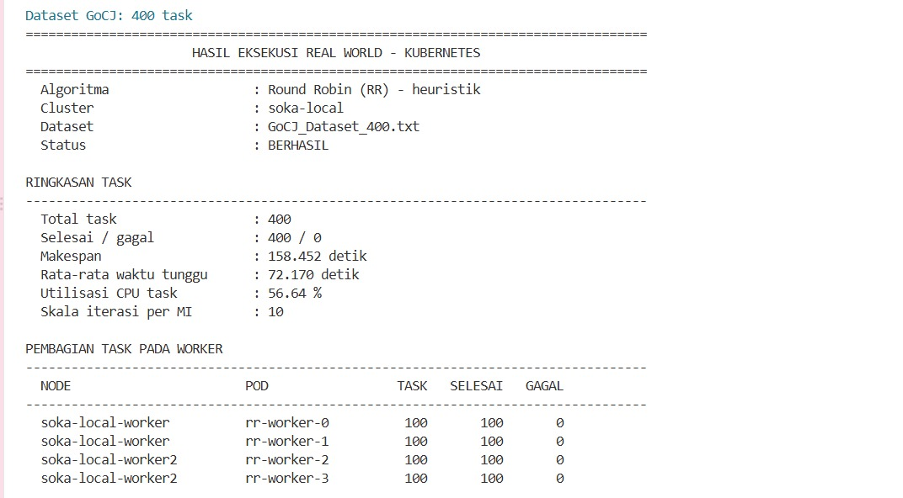

Sumber data: [summary.json](runs/20261030-231424/summary.json) dari run `20261030-231424`.


### 500 task

500 task selesai, 0 gagal; setiap pod menerima 125 task. Makespan **187.053 detik**.

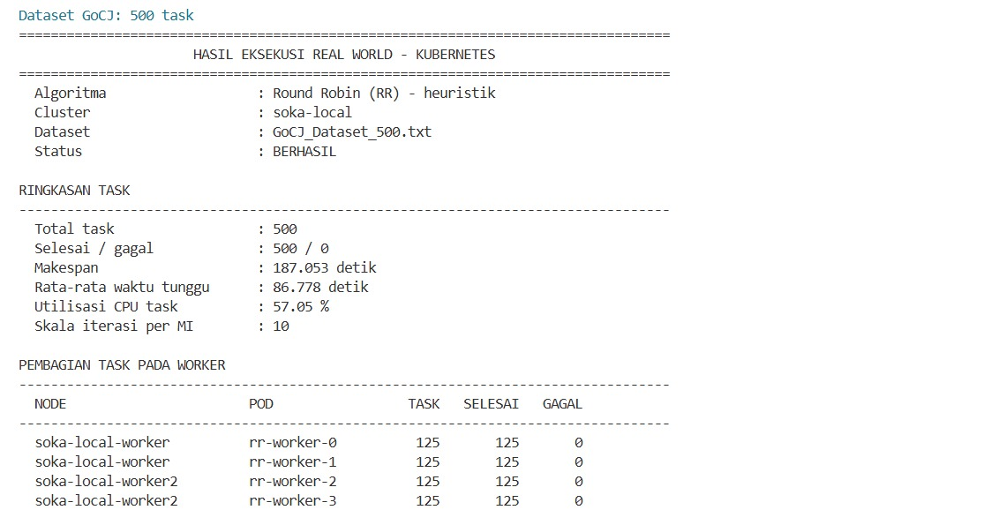

Sumber data: [summary.json](runs/20261030-231944/summary.json) dari run `20261030-231944`.


### 600 task

600 task selesai, 0 gagal; setiap pod menerima 150 task. Makespan **227.250 detik**.

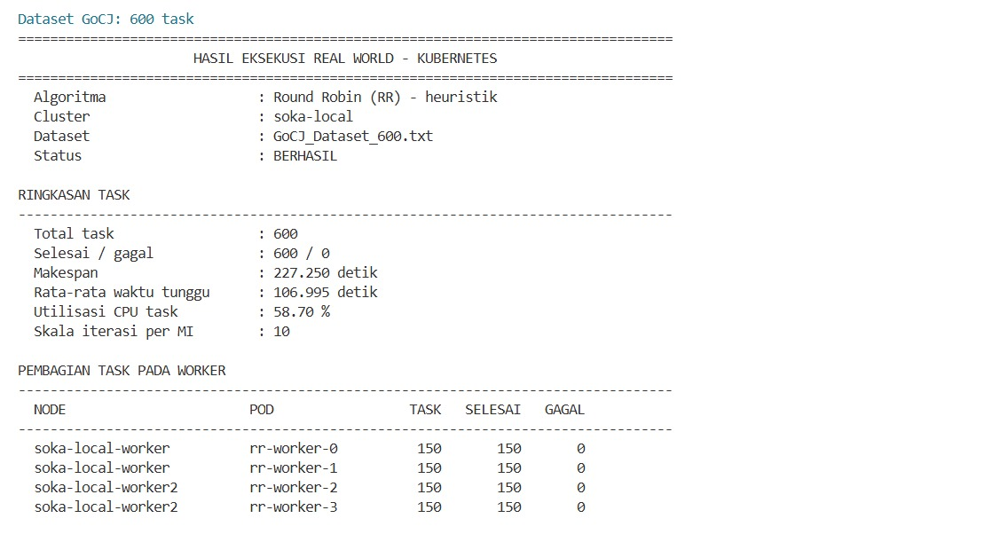

Sumber data: [summary.json](runs/20261030-232608/summary.json) dari run `20261030-232608`.


### 700 task

700 task selesai, 0 gagal; setiap pod menerima 175 task. Makespan **209.217 detik**.

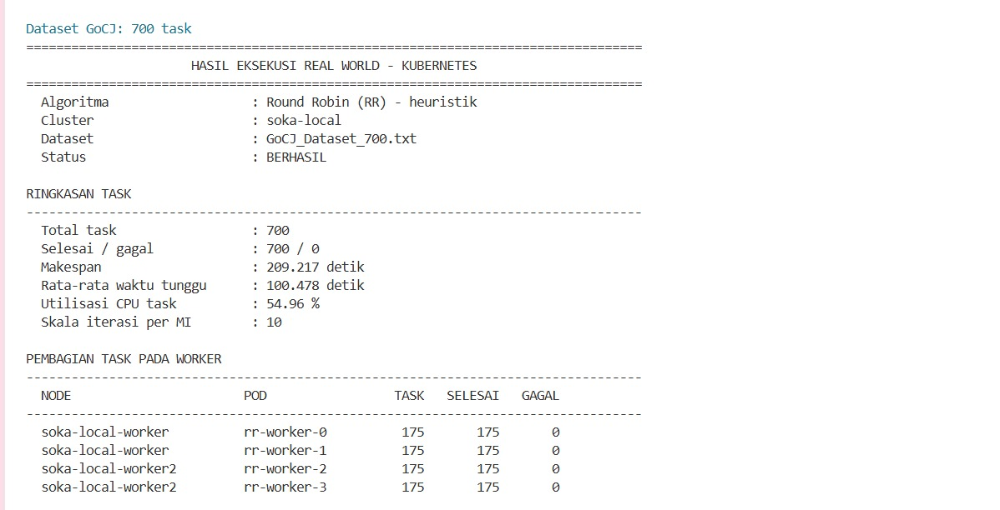

Sumber data: [summary.json](runs/20261030-233338/summary.json) dari run `20261030-233338`.


### 800 task

800 task selesai, 0 gagal; setiap pod menerima 200 task. Makespan **226.290 detik**.

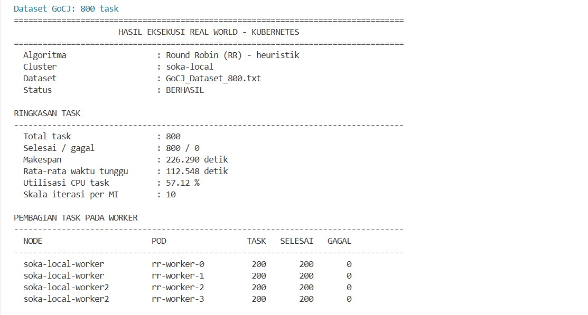

Sumber data: [summary.json](runs/20261030-234059/summary.json) dari run `20261030-234059`.


### 900 task

900 task selesai, 0 gagal; setiap pod menerima 225 task. Makespan **264.174 detik**.

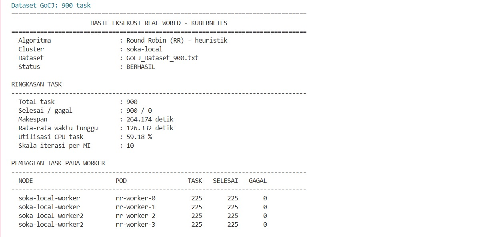

Sumber data: [summary.json](runs/20261030-234853/summary.json) dari run `20261030-234853`.


### 1000 task

1000 task selesai, 0 gagal; setiap pod menerima 250 task. Makespan **302.552 detik**.

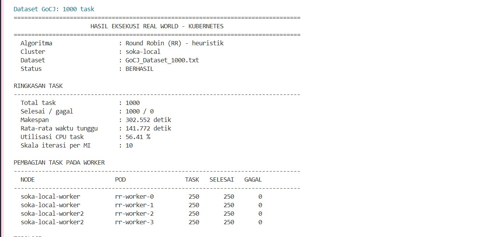

Sumber data: [summary.json](runs/20261030-235802/summary.json) dari run `20261030-235802`.

## Menjalankan dan membaca hasil

Dari PowerShell pada folder repository, dengan Docker Engine yang dipakai cluster tetap aktif:

```powershell
# Setup pertama
.\run-kubernetes.ps1 -Mode setup

# Periksa node/pod dan validasi topologi
.\run-kubernetes.ps1 -Mode inspect
.\run-kubernetes.ps1 -Mode verify

# Jalankan seluruh 100 task
.\run-kubernetes.ps1

# Jalankan seluruh 1000 task
.\run-kubernetes.ps1 -DatasetSize 1000

# Jalankan semua 19 dataset berurutan (10.450 task total)
.\run-kubernetes.ps1 -AllDatasets
```

Jalankan satu eksperimen pada satu waktu. Perintah AllDatasets benar-benar menjalankan komputasi dan dapat memerlukan waktu lama.

Untuk **menampilkan hasil tersimpan tanpa menjalankan ulang task**, tanpa Docker atau WSL:

```powershell
.\run-kubernetes.ps1 -Mode results -AllDatasets
.\run-kubernetes.ps1 -Mode results -AllDatasets -ExportPath hasil-seluruh-dataset.txt
```

Mode results memilih hasil seluruh task terbaru per ukuran dataset berdasarkan nama folder run. Hasil ini bisa berbeda dari run terpilih pada foto; label sumber run selalu dicantumkan. Python Windows diperlukan untuk mode baca hasil.

### File keluaran setiap run

| File | Fungsi |
|---|---|
| report.txt | Ringkasan rapi seperti terminal |
| summary.json | Metrik, status, nama dataset, ukuran dan SHA-256 sumber |
| tasks.csv | Task, pod, node, UID, waktu, checksum dan status/error |
| topology.json | Bukti node dan placement dari verifikasi API sebelum dispatch |
| plan.json | Pemetaan RR dan ukuran pekerjaan |

File tersimpan di `runs/<timestamp>/`. Foto tidak menggantikan data mentah; gunakan keduanya untuk menelusuri hasil. Panduan prasyarat, perintah alternatif WSL dan penanganan error tersedia di [Panduan Eksekusi](docs/PANDUAN-EKSEKUSI.md).

## Struktur implementasi

| File / direktori | Peran |
|---|---|
| run-kubernetes.ps1 | Pintu masuk PowerShell, profil aktif kind satu laptop |
| scheduler.py | Pemetaan RR, antrean paralel dan pencatatan hasil |
| kube_backend.py | Setup, pemeriksaan Kubernetes, dispatch dan format laporan |
| worker.py | Komputasi SHA-256 dalam pod |
| show_results.py | Membaca hasil tersimpan tanpa menghubungi cluster |
| kubernetes/kind.yaml | Satu control-plane dan dua worker berlabel host1/host2 |
| data/ | Seluruh dataset asli dan manifest keutuhan |
| runs/ | Hasil mentah setiap eksperimen |
| docs/images/ | Sepuluh foto dokumentasi 100-1000 task |
| docs/hasil-dokumentasi.csv | Tabel hasil yang sesuai dengan foto |
| docs/documentation-index.json | Pemetaan foto, checksum dan run sumber |
| tests/ | Pengujian algoritma, backend dan pembacaan hasil |

Kode jalur dua laptop tetap tersimpan sebagai alternatif historis, tetapi arsitektur dan dokumentasi hasil di README ini adalah **kind satu laptop**.

## Validasi dan batasan

```powershell
python -m unittest discover -s tests -p 'test_*.py' -v
```

Pengujian unit memakai respons API tiruan; bukti eksekusi nyata adalah file run dan screenshot di atas. Foto dan metrik dokumentasi telah dicocokkan dengan summary.json run sumber. Penyusunan README tidak menjalankan ulang task.

Seluruh worker berbagi hardware laptop dan waktu mencakup overhead dispatch. Eksperimen ini menunjukkan RR berhasil mengeksekusi pekerjaan pada konfigurasi tersebut; tidak membuktikan RR lebih unggul daripada algoritma lain atau memenuhi dua host fisik/empat VM secara harfiah.

## Anggota Kelompok 5

| NRP | Nama |
|---|---|
| 5027241009 | Tasya Aulia Darmawan |
| 5027241043 | Azaria Raissa Maulidinnisa |
| 5027241090 | Tiara Fatimah Azzahra |
| 5027241104 | Afriza Tristan Calendra Rajasa |
| 5027201047 | Made Gde Krisna Wangsa |

## Referensi

- [kind Quick Start](https://kind.sigs.k8s.io/docs/user/quick-start/)
- [Docker Desktop dengan WSL 2](https://docs.docker.com/desktop/features/wsl/)
- [Penempatan pod pada node Kubernetes](https://kubernetes.io/docs/concepts/scheduling-eviction/assign-pod-node/)
- [GoCJ: Google Cloud Jobs Dataset](https://data.mendeley.com/datasets/b7bp6xhrcd/1)
