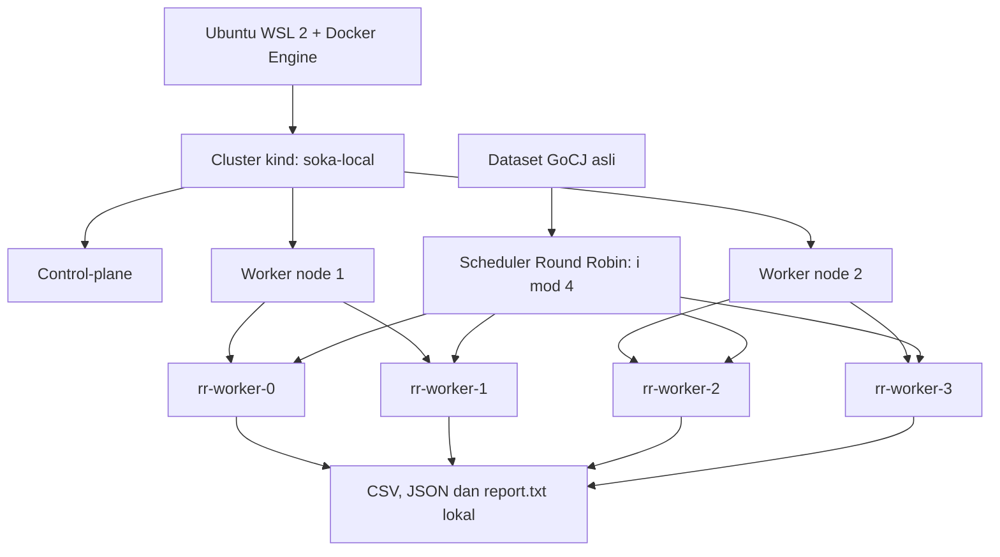

# Alur Aktif: Kubernetes Satu Laptop

1. Hentikan agent K3s percobaan pada laptopmu dan pastikan Docker Engine aktif.
2. Setup kind membuat satu control-plane, dua worker node dan empat pod.
3. Verifikasi membaca status, UID pod dan placement aktual melalui kubectl di container control-plane. Jalur kind memakai docker exec agar tidak tergantung port API yang dipublikasikan ke Windows/WSL.
4. Baca dataset GoCJ yang dipilih, kemudian bagi task bergiliran ke empat pod.
5. Eksekusi hash CPU nyata melalui kubectl exec, serial per pod dan paralel antarpod.
6. Simpan metrik dan checksum ke folder runs, lalu kumpulkan screenshot node/pod serta report.txt.

Node kind adalah container di satu laptop; pod bukan VM. Ini tidak membuktikan dua host fisik. Total tiga node mencakup satu control-plane dan dua worker. Mode ini tidak memerlukan server teman, portproxy atau NodePort. Seluruh dataset sebelumnya tetap tersedia.

Perintah lengkap ada di [README](../README.md). Jalur [K3s dua laptop](K3S-DUA-LAPTOP.md) hanya alternatif sebelumnya.
