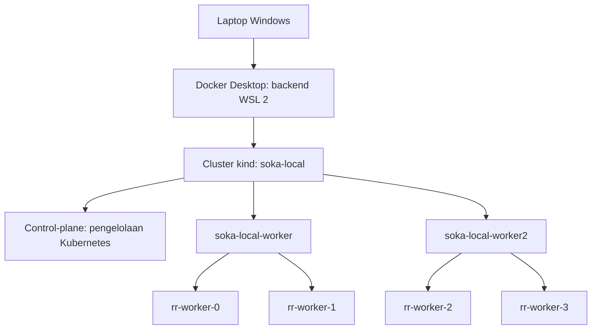
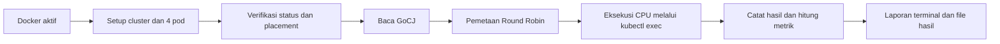

# Alur Tugas: Round Robin pada Kubernetes Lokal

Dokumen ini menjelaskan cara kerja dan urutan demonstrasi implementasi yang sudah tersedia. Untuk perintah utama lihat [README](../README.md), sedangkan rincian lingkungan ada di [panduan teknis](../README.md).

## 1. Tujuan dan susunan lingkungan

Tujuannya menjalankan task CPU nyata menggunakan heuristik RR pada Kubernetes. Lingkungan dibuat pada satu laptop: satu cluster kind dengan satu control-plane dan dua worker node; setiap worker node menampung dua pod Python.



Node kind adalah container, pod bukan VM. Tiga node di daftar Kubernetes berarti satu control-plane ditambah dua worker, bukan tiga worker. Cluster merupakan pengelompokan lab logis, bukan datacenter fisik.

## 2. Persiapan dan eksekusi adalah dua tahap berbeda

**Setup** membuat lingkungan: mengunduh kind/image, membuat cluster, memberi label worker, menerapkan empat pod dan menunggu kesiapan. Setup bukan penjadwalan task GoCJ.

**Run** memanfaatkan lingkungan tersebut: memverifikasi topologi, membaca dataset, membentuk pemetaan RR, menjalankan worker dan menulis hasil. Pod sudah berjalan sebelum task dikirim.



## 3. Peran Kubernetes dan algoritma proyek

Kubernetes menempatkan pod pada node sesuai nodeSelector. Label `soka.lab/host=host1` menerima rr-worker-0/1; label host2 menerima rr-worker-2/3. Verifikasi membaca nodeName aktual dari API, bukan hanya mengandalkan manifest.

Algoritma RR proyek memilih pod tujuan setiap task:

```text
pod_index = task_index % 4
```

| Task | Pod | Node |
|---:|---|---|
| 0 | rr-worker-0 | soka-local-worker |
| 1 | rr-worker-1 | soka-local-worker |
| 2 | rr-worker-2 | soka-local-worker2 |
| 3 | rr-worker-3 | soka-local-worker2 |
| 4 | rr-worker-0 | soka-local-worker |
| 5 | rr-worker-1 | soka-local-worker |
| 6 | rr-worker-2 | soka-local-worker2 |
| 7 | rr-worker-3 | soka-local-worker2 |

Untuk 20 task, tiap pod memperoleh 5 task. Ini pemerataan jumlah task, bukan jaminan pemerataan durasi, karena panjang task GoCJ berbeda-beda. RR membagi task bergiliran tanpa optimasi fitness berbobot.

## 4. Urutan satu run

```mermaid
sequenceDiagram
    participant User as Pengguna
    participant PS as PowerShell
    participant RR as Scheduler Python di WSL
    participant API as Kubernetes API / kubectl
    participant Pod as Pod worker tujuan
    User->>PS: run-kubernetes.ps1
    PS->>RR: run --dataset-size 100
    RR->>API: Baca node, pod, status, nodeName dan UID
    API-->>RR: Dua worker Ready, empat pod Running/Ready
    RR->>RR: Baca dataset dan petakan task i ke i mod 4
    loop Antrean setiap pod serial; keempat antrean paralel
        RR->>API: Pastikan UID pod masih sama
        RR->>Pod: kubectl exec: Python worker lewat stdin
        Pod->>Pod: Ulangi SHA-256 sesuai panjang task
        Pod-->>RR: Checksum, CPU time dan wall time
    end
    RR->>RR: Tulis CSV, JSON dan report.txt
    RR-->>User: Metrik, task per pod dan topologi
```

Jika verifikasi gagal, run berhenti sebelum dispatch. Jika satu task gagal, hasil kegagalan dicatat dan antrean tetap diproses; run berakhir dengan exit code 1. Scheduler tidak memindahkan task gagal ke worker lain atau mengganti eksekusi dengan simulasi.

## 5. Apa yang membuktikan pekerjaan nyata?

Worker menerima ID task dan jumlah iterasi, lalu menjalankan SHA-256 berulang dalam container pod. Waktu CPU diukur dari proses worker. Respons berisi checksum deterministik sehingga hasil dapat diperiksa ulang.

Panjang GoCJ dikalikan skala iterasi untuk membentuk beban CPU. Ini bukan eksekusi pekerjaan asli Google, dan nilai MI bukan pengukuran instruksi hardware. Kubectl exec serta pemeriksaan identitas menambah overhead; karena itu durasi run tidak setara dengan waktu estimasi analitis.

## 6. Urutan demonstrasi

Dari PowerShell pada folder proyek:

1. Pastikan Docker Desktop aktif.
2. Tampilkan topologi aktual:

   ```powershell
   wsl -d Ubuntu --cd "$PWD" -- ./.tools/kubernetes-bin/kubectl --context kind-soka-local get nodes -o wide
   wsl -d Ubuntu --cd "$PWD" -- ./.tools/kubernetes-bin/kubectl --context kind-soka-local -n soka-heuristik get pods -o wide
   ```

3. Periksa kesiapan:

   ```powershell
   .\run-kubernetes.ps1 -Mode verify
   ```

4. Tampilkan pola RR delapan task:

   ```powershell
   .\run-kubernetes.ps1 -Mode plan -Tasks 8
   ```

5. Jalankan seluruh dataset default 100 task:

   ```powershell
   .\run-kubernetes.ps1
   ```

6. Buka folder hasil yang ditampilkan. Cocokkan report.txt dengan summary.json dan tasks.csv dari run yang sama.

Kalimat penjelasan demonstrasi:

> Sistem menggunakan satu cluster Kubernetes lokal dengan dua worker node dan dua pod pada setiap worker. Round Robin membagikan task GoCJ bergiliran ke empat pod. Setiap pod menjalankan pekerjaan CPU nyata, lalu hasil dan metrik dicatat untuk evaluasi. Lingkungan node dijalankan oleh kind dalam Docker pada satu laptop; pod bukan VM.

## 7. Batas hasil dan metrik

Makespan mencakup overhead controller/kubectl, waiting time sampai pemanggilan task, dan utilisasi dihitung dari CPU time task terhadap empat limit CPU pod. Nilai tersebut bukan utilisasi seluruh laptop. Keempat pod berbagi hardware dan tidak mencadangkan empat core fisik. Satu run yang sukses membuktikan eksekusi pada konfigurasi tersebut, bukan keunggulan RR atas algoritma lain.
