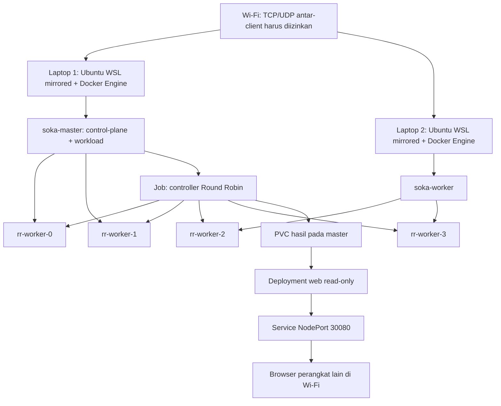
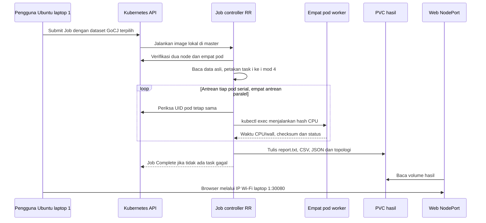

# Alur Sistem K3s Dua Laptop

Lihat [panduan langkah demi langkah](K3S-DUA-LAPTOP.md) untuk perintah lengkap dan [README](../README.md) untuk ringkasan tugas.

## Persiapan (sekali sebelum eksperimen)

1. Pastikan versi Windows mendukung WSL mirrored networking, systemd aktif dan Docker Engine native tersedia pada masing-masing Ubuntu.
2. Buka hanya port yang diperlukan dengan cakupan IP peer/subnet yang jelas.
3. Jalankan uji TCP dan UDP 8472 dalam dua arah. Jangan lanjut bila Wi-Fi memblokir komunikasi.
4. Pasang server K3s pada laptop 1 dan agent versi sama pada laptop 2, menggunakan runtime Docker.
5. Label host1 untuk master dan host2 untuk agent. Master menerima workload juga.
6. Build satu image aplikasi, transfer tar dan load pada Engine kedua laptop.
7. Terapkan empat worker, RBAC, PVC, Deployment web dan NodePort.

## Eksekusi (setiap run)

RR membagi task ke pod; Kubernetes menempatkan pod ke node. Untuk 100 task tiap pod memperoleh 25 task, tetapi durasi tidak harus sama karena bobot GoCJ berbeda-beda. Input tetap dataset sebelumnya, bukan data sintetis yang dibuat ulang. Nilai dataset diskalakan menjadi iterasi hash dan bukan pengukuran instruksi hardware.

## Bukti dan batasan

Catat dua node dengan IP berbeda, dua pod RR pada setiap node, Job Complete, hasil tanpa kegagalan dan akses halaman dari perangkat lain. Verifikasi juga HTTP antarpod lintas node sesuai panduan. Node Ready saja belum cukup untuk membuktikan jaringan pod berfungsi.

Pod bukan VM. Dua objek Node tidak otomatis membuktikan dua perangkat fisik; sertakan bukti kedua laptop. Runtime menggunakan Docker Engine dalam WSL, sementara WSL 2 sendiri tetap memakai virtualisasi bawaan Windows. Deployment lintas laptop dan kebijakan jaringan kampus harus diuji langsung; pengujian unit tidak menggantikannya.
